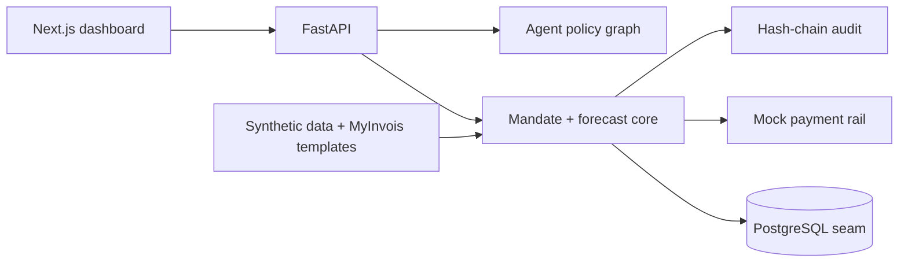

# Architecture and data flow

The frontend calls JSON endpoints for forecast, envelopes, financing, agent
messages, payments, and audit events. The backend is the policy boundary:
agent text is checked before any action, mandates validate supplier/purpose/
limits/expiry, and every approval or block is appended to the audit chain.
The current MVP keeps state in process memory so the demo starts without
infrastructure; `backend/app/db.py` is the replacement seam for PostgreSQL.
